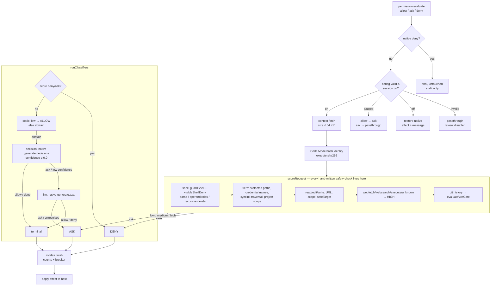

# OpenCode Auto Mode

Automatic review of OpenCode permission requests. While a session's auto mode is
on, the plugin reviews native **allow** and **ask** effects, including saved
**Always** approvals. A native **deny** is always final.

Auto Mode reduces prompts. It is not a security sandbox, and it cannot make an
invalid configuration fail closed.

## Requirements

- OpenCode V2. The checked-in plugin SDK and schema targets OpenCode `2.2.0`.
- Model references only if you use `decision` or `llm` classifier stages. Models
  and provider credentials belong in your personal OpenCode provider config.
  This repository supplies no model, endpoint, credential, or allowlist.
- **Data egress:** a configured `decision` or `llm` stage sends the action and
  resources (including full Code Mode source), agent, project/worktree, git
  state, and up to 12 KB of user messages to that model's provider, even with
  audit off. Choose a provider you trust.

## Install

Register the plugin **once** in your user-owned global config:

`~/.config/opencode/opencode.jsonc` (or
`$XDG_CONFIG_HOME/opencode/opencode.jsonc`). The global config must be outside
the repository, resolve with no symlink in its path, be user-owned and not
group/other-writable, be a single hardlink, and use an absolute
`XDG_CONFIG_HOME` when set.

```jsonc
{
  "$schema": "https://opencode.ai/config.json",
  "plugins": [{
    "package": "@mortz.prk/opencode-auto-mode",
    "options": {
      "classifiers": [
        { "type": "static" },
        { "type": "llm", "model": "<provider>/<reviewer-model>" }
      ]
    }
  }]
}
```

The `static` stage handles low-risk reads and eligible in-project edits without a
model. Remove the `llm` stage if you want a static-only setup; anything static
cannot resolve then asks you.

For native typed decisions, add a `decision` stage between `static` and `llm`:

```jsonc
{ "type": "decision", "model": "<provider>/<decision-model>", "minConfidence": 0.9 }
```

Only add this stage if your OpenCode provider supports native decisions. The
plugin has no HTTP decision adapter or custom endpoint option.

Keep the plugin registration in global config only. Do not add the full plugin to
project config, `cli.json`, or `.opencode/plugins/` as well: the plugin reads its
safety options from exactly one global registration. The server registration
loads the TUI part automatically. Desktop loads the experimental GUI part from
global config and needs the built `dist/gui-experimental.cjs` bundle; in a local
checkout, run `bun run build:gui` first.

## Verify

Restart nothing for a config-only change. OpenCode watches config files and
reloads plugins after a save; `/reload` forces a full reload if needed.

Run:

```text
/auto-mode status
```

A working install reports `Auto mode: on`, today's allow/ask/deny counts, active
reviews, and breaker state. With invalid configuration, the command reports
`Auto mode: invalid` and `Review disabled: <error>`; the desktop pill reads
`Invalid config — review disabled`. A storage or status failure is not a config
error: the command appends its error and the pill reads `Review unavailable` or
`status unavailable`. Fix the strict option shapes below rather than expecting a
migration hint.

## Use

- `/auto-mode` toggles the current session.
- `/auto-mode on` enables review and resets the breaker.
- `/auto-mode off` restores the native host effect.
- `/auto-mode status` reports mode, counts, active reviews, and breaker state.

Configure native permissions for ordinary safe work and leave residual risky
operations as `ask`. Keep hard denials in user-owned global `policies`
(`tool.use`); the plugin does not install or rewrite native rules.

## Options

Unknown keys are rejected. `classifiers` is required and must contain 1–64
ordered stages, with at most one `static` stage.

| Option | Default | Contract |
| --- | --- | --- |
| `classifiers` | required | Ordered `static`, `decision`, and `llm` stages. No default list and no unconfigured mode. |
| `reviewTimeoutMs` | `15000` | Whole-review deadline; integer 1–120000. |
| `breaker` | `3 / 10 / 50` | `{consecutiveDenies, windowDenies, windowSize}`. All three keys are required when supplied. |
| `tui` | `true` | Show or hide the TUI indicator. UI-only; review still runs server-side. |
| `audit` | `{enabled:false,maxBytes:10485760}` | Object only. Local audit is off by default. |

Stage shapes:

| Stage | Shape |
| --- | --- |
| `static` | `{ "type": "static", "allowInProjectEdits"?: boolean }` |
| `decision` | `{ "type": "decision", "model": "<provider>/<model>", "timeoutMs"?: number, "minConfidence"?: number }` |
| `llm` | `{ "type": "llm", "model": "<provider>/<model>", "timeoutMs"?: number }` |

## How review works

1. Native permissions, policies, and saved approvals produce `allow`, `ask`, or
   `deny`. A native **deny is final** and is never reviewed or weakened.
2. With mode on, native allows and asks are reviewed. Saved **Always** entries
   are re-reviewed but never deleted or rewritten.
3. Built-in guards run first: protected paths and credentials, risky shell
   structure, recursive external deletion, history changes, and ambiguous syntax.
   These guards are not user-extensible.
4. Configured classifiers run in array order. A static stage may resolve low-risk
   work; a decision stage uses OpenCode's native decision API; an LLM stage uses
   its explicit reviewer. The first decisive allow or deny stops the chain.
5. Exhaustion, unusable context, interruption, failure, or timeout resolves to
   **ask**. A deny ends with `Continue with a safer alternative.`

Mode off restores the original host effect. A paused breaker turns a reviewed
native allow into `ask`; an existing native ask keeps its prompt.

Assuming classifiers: [static, decision, llm] (array order is authoritative).



## Safety limits

- **Native Auto/YOLO is client-local.** If enabled, OpenCode may auto-approve an
  `ask` without a dialog, including a plugin ask. Plugin checks still run and
  plugin denies still block, but the plugin cannot read, change, or synchronize
  that switch. Disable client Auto/YOLO if you need prompts.
- **Invalid configuration acts disabled.** The plugin performs no review and
  native behavior applies. That is passthrough, not fail-closed.
- Coverage is limited to the permission `evaluate` hook and the Code Mode
  `execute.before` bridge. Native path grants are not an OS sandbox.
- Code Mode stays HIGH: JavaScript can hide egress behind aliases and computed
  URLs. Its permission identity is the SHA-256 of the exact UTF-8 source. Old
  raw-code approvals generally do not match.
- Other project plugins can affect residual effects; only run code you trust.

## Audit

Audit is the only plugin-generated telemetry and is **off by default**. It is
local and unsafe: raw records are unredacted and can contain secrets, file
contents, prompts, and model outputs. If enabled, the fixed path is
`$XDG_STATE_HOME/opencode-auto-mode/decisions.jsonl` (or
`~/.local/state/opencode-auto-mode/decisions.jsonl` when `XDG_STATE_HOME` is not
absolute). Rotated archives are retained; delete them manually. See
[README.llm.md](README.llm.md#audit-and-replay) before enabling it.

## More documentation

- [README.llm.md](README.llm.md) — installation instructions for an AI agent,
  full options, migration from 1.0.x, audit, and troubleshooting.
- [CONTRIBUTING.md](CONTRIBUTING.md) — repository map, local development,
  tests, and release checks. It ships with the package.

## Credit

Created originally by [Andrew Mellen (mellena1)](https://github.com/mellena1) in
[mellena1/opencode-auto-mode](https://github.com/mellena1/opencode-auto-mode).
This independent project retains the original [MIT license](LICENSE).
