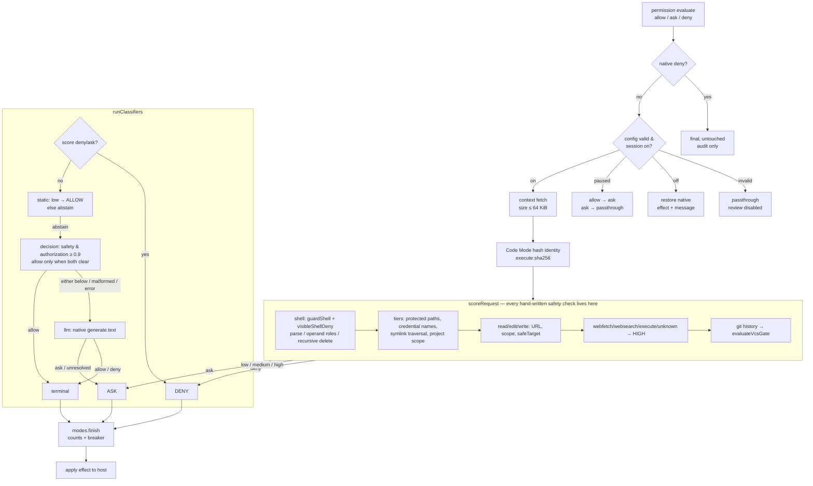

# OpenCode Auto Mode

Automatic review of OpenCode permission requests. While a session's auto mode is
on, the plugin reviews native **allow** and **ask** effects, including saved
**Always** approvals. A native **deny** is always final.

Auto Mode reduces prompts. It is not a security sandbox, and it cannot make an
invalid configuration fail closed.

## Requirements

- OpenCode V2. The checked-in plugin SDK and schema targets OpenCode `2.2.0`.
- Model references only if you use `decision`, `fact-review`, or `llm`
  classifier stages. Models and provider credentials belong in your personal
  OpenCode provider config. This repository supplies no model, endpoint,
  credential, or allowlist.
- **Data egress:** a configured `decision`, `fact-review`, or `llm` stage sends
  the action and resources (including full Code Mode source), project/worktree,
  and up to 12 KB of combined root and delegated user text to that model's
  provider, even with audit off. The decision stage sends compact evidence plus
  selected operation details. The fact-review stage first sends operation-only
  classification evidence without user text, then, only for a certified fact,
  the same compact review evidence as the decision stage. The llm stage also
  receives the agent, broader bounded evidence, and Git state. The decision
  stage includes Git state only for git-related actions. Choose a provider you
  trust.

## Install

Register the plugin **once** in your user-owned global config:

`~/.config/opencode/opencode.jsonc` (or
`$XDG_CONFIG_HOME/opencode/opencode.jsonc`). The global config must be outside
the repository, resolve with no symlink in its path, be user-owned and not
group/other-writable, be a single hardlink, and use an absolute
`XDG_CONFIG_HOME` when set.

```jsonc
{
  "$schema": "https://opencode.ai/config.json",
  "plugins": [{
    "package": "@mortz.prk/opencode-auto-mode",
    "options": {
      "classifiers": [
        { "type": "static" },
        { "type": "llm", "model": "<provider>/<reviewer-model>" }
      ]
    }
  }]
}
```

The `static` stage handles low-risk reads and eligible in-project edits without a
model. Remove the `llm` stage if you want a static-only setup; anything static
cannot resolve then asks you.

For native typed decisions, add a `decision` stage between `static` and `llm`:

```jsonc
{ "type": "decision", "model": "<provider>/<decision-model>", "minConfidence": 0.9 }
```

Only add this stage if your OpenCode provider supports native decisions. The
plugin has no HTTP decision adapter or custom endpoint option. The stage asks
two separate predicate questions, `safety` and `authorization`; they are not
claimed to be statistically independent. It allows only when both model-reported
probabilities meet `minConfidence` (default `0.9`); otherwise it abstains.
Ordinary abstentions continue to the next configured stage. Terminal evidence
loss is limited to resource-body redaction, an external directory without a
verified target, or an explicitly incomplete operation whose only resources are
`*`. It never denies. `minConfidence` is a per-predicate probability
floor, not a confidence in a chosen label; lower values are more permissive and
probabilities are not a calibrated certainty guarantee. The decision stage
receives compact evidence: the action and resources, selected operation details
when available, the host platform and requested shell interpreter (bounded), and
one chronological user-message source. Ordinary incomplete operation evidence
abstains before generation; terminal evidence loss is scoped as above.

Keep the plugin registration in global config only. Do not add the full plugin to
project config, `cli.json`, or `.opencode/plugins/` as well: the plugin reads its
safety options from exactly one global registration. The server registration
loads the TUI part automatically. Desktop loads the experimental GUI part from
global config and needs the built `dist/gui-experimental.cjs` bundle; in a local
checkout, run `bun run build:gui` first.

## Verify

Restart nothing for a config-only change. OpenCode watches config files and
reloads plugins after a save; `/reload` forces a full reload if needed.

Run:

```text
/auto-mode status
```

A working install reports `Auto mode: on`, today's allow/ask/deny counts, active
reviews, and breaker state. With invalid configuration, the command reports
`Auto mode: invalid` and `Review disabled: <error>`; the desktop pill reads
`Invalid config — review disabled`. A storage or status failure is not a config
error: the command appends its error and the pill reads `Review unavailable` or
`status unavailable`. Fix the strict option shapes below rather than expecting a
migration hint.

## Use

- `/auto-mode` toggles the current session.
- `/auto-mode on` enables review and resets the breaker.
- `/auto-mode off` restores the native host effect.
- `/auto-mode status` reports mode, counts, active reviews, and breaker state.

Configure native permissions for ordinary safe work and leave residual risky
operations as `ask`. Keep hard denials in user-owned global `policies`
(`tool.use`); the plugin does not install or rewrite native rules.

## Options

Unknown keys are rejected. `classifiers` is required and must contain 1–64
ordered stages, with at most one `static` stage.

| Option | Default | Contract |
| --- | --- | --- |
| `classifiers` | required | Ordered `static`, `decision`, `fact-review`, and `llm` stages. No default list and no unconfigured mode. |
| `reviewTimeoutMs` | `15000` | Whole-review deadline; integer 1–120000. |
| `breaker` | `3 / 10 / 50` | `{consecutiveDenies, windowDenies, windowSize}`. All three keys are required when supplied. |
| `tui` | `true` | Show or hide the TUI indicator. UI-only; review still runs server-side. |
| `audit` | `{enabled:false,maxBytes:10485760}` | Object only. Local audit is off by default. |

Stage shapes:

| Stage | Shape |
| --- | --- |
| `static` | `{ "type": "static", "allowInProjectEdits"?: boolean }` |
| `decision` | `{ "type": "decision", "model": "<provider>/<model>", "timeoutMs"?: number, "minConfidence"?: number }`. Allows only when both `safety` and `authorization` predicates meet `minConfidence` (default `0.9`); otherwise abstains. |
| `fact-review` | `{ "type": "fact-review", "model": "<provider>/<model>", "timeoutMs"?: number, "minConfidence"?: number }`. Experimental and opt-in. `minConfidence` defaults to `0.9` and values below `0.8` are rejected. See [Fact review](#fact-review-experimental). |
| `llm` | `{ "type": "llm", "model": "<provider>/<model>", "timeoutMs"?: number }` |

## How review works

1. Native permissions, policies, and saved approvals produce `allow`, `ask`, or
   `deny`. A native **deny is final** and is never reviewed or weakened.
2. With mode on, native allows and asks are reviewed. Saved **Always** entries
   are re-reviewed but never deleted or rewritten.
3. Built-in guards run first: protected paths and credentials, risky shell
   structure, recursive external deletion, history changes, and ambiguous syntax.
   These guards are not user-extensible. Ordinary configuration, ambiguous
   credential-like names, unresolved paths, Git metadata (`.git`), Git global
   options, and complex POSIX shell syntax are left to the configured decision/LLM
   stages, not automatically denied or forced to a user prompt. Established credential-store
   protections and visible blocked operations still take precedence. Unsupported
   shell dialects are reviewed from their complete raw text without POSIX-derived
   denials. Missing scope/VCS facts also reach review; deliberate history gates
   for a known default branch or dirty tree remain human decisions. Loading a skill is
   low-risk: it loads instructions, not executable code; later tool calls are
   checked separately.
4. Configured classifiers run in array order. A static stage may resolve low-risk
   work; a decision stage uses OpenCode's native decision API and allows only
   when both predicate probabilities clear the threshold; a fact-review stage
   certifies an operation fact and either allows a certified read-only
   inspection or runs a separate safety/authorization review; an
   LLM stage uses its explicit reviewer. The first decisive allow or deny stops
   the chain.
5. Exhaustion, unusable context, interruption, failure, or timeout resolves to
   **ask**. A deny ends with `Continue with a safer alternative.`

Mode off restores the original host effect. A paused breaker turns a reviewed
native allow into `ask`; an existing native ask keeps its prompt.

Assuming classifiers: [static, decision, llm] (array order is authoritative).



### Decision evidence and fallback

The decision stage builds compact evidence once: action and resources, optional
selected operation details from host metadata and the captured tool call when
available, the host platform and requested shell interpreter (bounded), one
chronological root-session user-message source, concrete static-analysis
findings, and git state only for git-related actions. Raw metadata/source blobs
and agent prose are not sent. If a shared call identity makes the capture
unavailable or ambiguous, the operation is incomplete rather than guessed.

User authority comes only from the root session. The plugin follows `parentID`
to the root within 16 sessions, rejects cycles, and reads each session's metadata
and context once. Descendant user prompts are preserved separately as delegation
context in root-to-leaf order; they are nonauthority, may narrow the local task,
and cannot grant authorization, broaden scope, or revoke a parent restriction.
Root and delegation text share a 12,000-byte budget. Authority is taken at
request start (`asOf`): user messages created later are excluded from root
authority and delegation, and a non-finite cutoff or message timestamp fails
closed to **ask**. Non-null `fork` metadata also asks because forked authority
provenance is unresolved; only live `fork: null` is not a fork, and forked user
text is never reclassified as delegation. A `compaction` message in active root
or delegation context is degraded and asks. Missing root/parent/context
evidence, cycles, depth overflow, or oversized text is terminal and resolves to
**ask**; text is never truncated and restrictions are never dropped. These are
correctness rules, not an `80%` claim.

Ordinary incomplete operation evidence abstains before generation and continues.
Terminal evidence loss is limited to resource-body redaction, an external
directory without a verified target, or an explicitly incomplete operation whose
only resources are `*`. A complete unknown MCP operation with sanitized arguments
is not terminal; it remains model-reviewed. Unknown capability is not
structurally safe, so the safety probability must account for it. The LLM may
infer semantics from the exact tool and arguments, but there is no declared
verification. An ordinary abstain is not a deny: later stages may still allow,
deny, or ask. LLM output is not ground truth. Malformed output, provider errors,
timeouts, and exhaustion end in **ask** when no later stage decides.

### Fact review (experimental)

`fact-review` is an explicit opt-in stage. It is not in the default
`[static, llm]` example, is never inserted automatically, and requires a provider
that supports native decision questions of both `choice` and `predicate` types.
The plugin never adds the stage or edits global config. The classifier list
remains authoritative; omitting the stage leaves existing defaults and stage
order unchanged.

```jsonc
{ "type": "fact-review", "model": "<provider>/<model>", "minConfidence": 0.9 }
```

For non-edit requests, the stage first classifies only what the operation is:
one `inspection` choice. A complete non-shell, non-file tool call instead asks
one `tool_readonly` choice with its tool name and captured arguments. A Code
Mode `execute` call is classified under its own script kind, which always gets
the full `safety` and `authorization` review; Code Mode is dynamic execution, so
no fact-only shortcut applies. If inspection does not clear the floor (including
a confident `false`), a shell command is classified per segment only when the
host identifies the interpreter as `bash` or `sh`. The plugin does not supply
that interpreter evidence, so with the plugin a command uses whole-command
checks. When per-segment classification applies, each segment gets the same
`inspection` choice first, and only a segment below the floor gets
`segment_local`, with one leading literal `cd` folded into the confined segment
cwd. Every segment read-only certifies read-only `inspection`; otherwise every
segment must be local at or above the floor. A command that cannot be split gets
one `operation_kind` choice, where `test_run` or `repository_read` certifies.
Per-segment questions also receive the whole command as `fullCommand` context,
and an unsplittable command whose `operation_kind` does not certify gets one
`command_local` choice, whose `true` certifies `command_local` and still
requires the full review. A model-derived
fact is certified only when its reported probability clears the threshold, its exact
source-input hash is present, and it carries a model label: the provider-reported
served model when the response includes one, otherwise the configured model reference.
A certified read-only `inspection`
with zero static analysis findings is allowed on that fact alone: no review call
is made. A certified `shell_segments` fact with zero static analysis findings is
likewise allowed on that fact alone as project-local, and keeps that full review
with any finding or without static analysis. A certified metadata-only
`project_edit` from the in-project `edit_in_project` question is also allowed on
that fact alone. Only those three certified kinds can skip review; every other
kind, including a Code Mode script fact, is reviewed. A `bash` fact is reviewed
because the mandatory score's shell guards evaluate only `shell`, and an
uncorrelated operation capture abstains instead of allowing. Captured shell or
file targets that conflict with the scored resources are carried as blocking
findings, so those paths also take the full review. Every other
certified fact receives the frozen `safety` and
`authorization` review questions, and allows only when the fact probability, the
raw `allow` probability, and `safety` all meet `minConfidence`; otherwise it
abstains. A complete `subagent` or `task` delegation with a non-empty captured
`prompt` is certified as `delegation` without a fact call and gets one review
call with only the frozen `authorization` question, allowing only when the
selected choice is `allow` and the raw `allow` probability meets
`minConfidence`; child actions are reviewed separately. A certified `inspection` with any static finding, or without static
analysis, also keeps that full review. The stage never denies. Mandatory score
deny/ask guards run first and are never overridden by this stage. Unknown facts,
missing source-input hash or model label, malformed output, low probabilities,
provider errors, and stage-local timeouts abstain and continue to the next
stage; a pipeline that no stage decides still asks. Cancellation and the
whole-review deadline are terminal instead: they stop the stage chain and
resolve to **ask** without running a later classifier. Terminal
preflight loss (a protected path, redacted resources or delegations, or missing
root authority) also resolves to **ask**.

`timeoutMs` defaults to `reviewTimeoutMs` (`15000`), and classification plus
review share that one deadline. `minConfidence` defaults to `0.9` and accepts
`0.8` through `1`; lower values are rejected. Unlike the general decision stage
it does not accept the full 0-1 range. A reported probability is not a
calibrated certainty guarantee. No accuracy target, `80%`
claim, or dataset statistic is made; small local samples are brittle and are not
documented here.

Fact classification receives operation evidence only: action, resources,
selected operation details, and project/worktree, but no user messages or
delegations. When the fact is certified and a review call is made, that call
receives the same compact evidence as the decision stage, including root
authority and delegation context
under the existing 12 KB budget and `asOf` cutoff described in
[Decision evidence and fallback](#decision-evidence-and-fallback). Root messages
remain the only authority; delegations only narrow.

Edit bodies are not configurable, and no plugin-config key enables body egress.
`includeEditPayload` is a host API option, not a plugin-config key; an unknown
option is rejected. With the plugin's default `false`, an `edit` action whose
targets all resolve inside the worktree and outside `.git`, `.jj`,
`node_modules` and secret-like names, with zero static findings, is asked one
metadata-only `edit_in_project` question carrying only the tool,
project-relative targets and project name, and `true` at or above the floor
certifies `project_edit` and
allows with no review call; every other edit-like request abstains and continues
to the next stage. When a host enables `includeEditPayload` and a consented,
host-minted, bounded edit body certifies `local_edit` at or above the floor,
that same body is included as
`changeContent` in the `safety`/`authorization` review, and the edit is allowed
only if the fact, `safety`, and `allow` gates all clear. That body-review
guarantee is scoped to body-captured `local_edit` facts: a metadata-only
`project_edit` can allow without capturing or reviewing the edit body. Audit
behavior is unchanged: opt-in, local, and unredacted as described in
[Audit](#audit).

## Safety limits

- **Native Auto/YOLO is client-local.** If enabled, OpenCode may auto-approve an
  `ask` without a dialog, including a plugin ask. Plugin checks still run and
  plugin denies still block, but the plugin cannot read, change, or synchronize
  that switch. Disable client Auto/YOLO if you need prompts.
- **Invalid configuration acts disabled.** The plugin performs no review and
  native behavior applies. That is passthrough, not fail-closed.
- Coverage is limited to the permission `evaluate` hook and the Code Mode
  `execute.before` bridge. Native path grants are not an OS sandbox.
- Code Mode stays HIGH: JavaScript can hide egress behind aliases and computed
  URLs. Its permission identity is the SHA-256 of the exact UTF-8 source. Old
  raw-code approvals generally do not match.
- Other project plugins can affect residual effects; only run code you trust.

## Audit

Audit is the only plugin-generated telemetry and is **off by default**. It is
local and unsafe: raw records are unredacted and can contain secrets, file
contents, prompts, and model outputs. If enabled, the fixed path is
`$XDG_STATE_HOME/opencode-auto-mode/decisions.jsonl` (or
`~/.local/state/opencode-auto-mode/decisions.jsonl` when `XDG_STATE_HOME` is not
absolute). Rotated archives are retained; delete them manually. See
[README.llm.md](README.llm.md#audit-and-replay) before enabling it.

## More documentation

- [README.llm.md](README.llm.md) — installation instructions for an AI agent,
  full options, migration from 1.0.x, audit, and troubleshooting.
- [CONTRIBUTING.md](CONTRIBUTING.md) — repository map, local development,
  tests, and release checks. It ships with the package.

## Credit

Created originally by [Andrew Mellen (mellena1)](https://github.com/mellena1) in
[mellena1/opencode-auto-mode](https://github.com/mellena1/opencode-auto-mode).
This independent project retains the original [MIT license](LICENSE).
